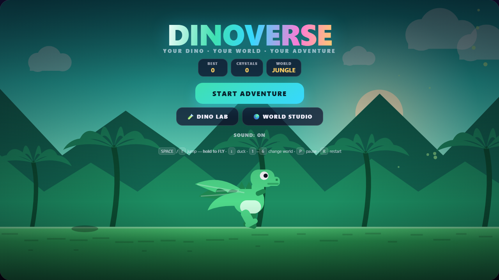
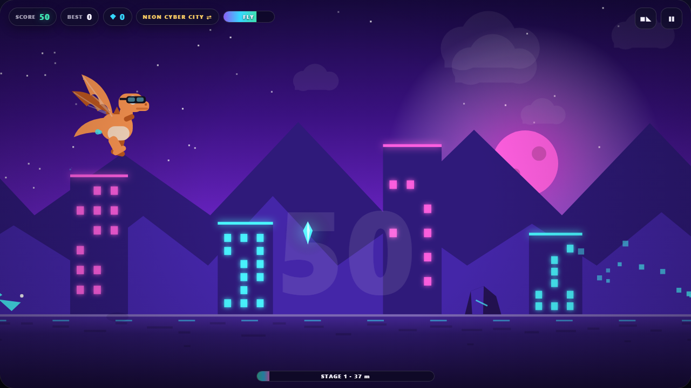
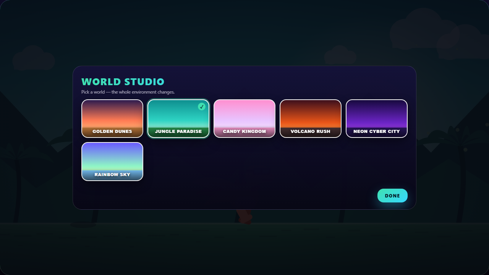
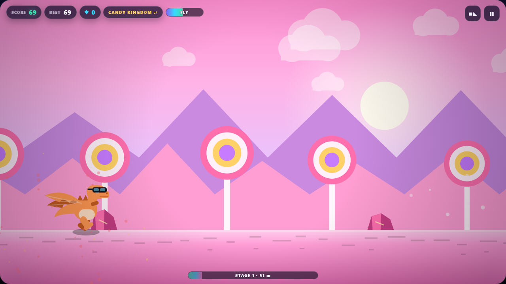
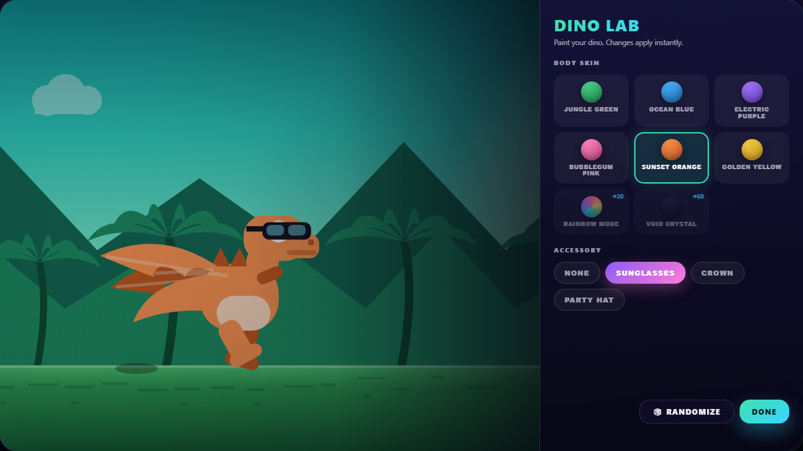
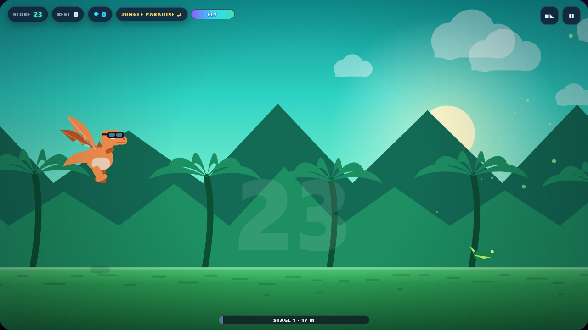
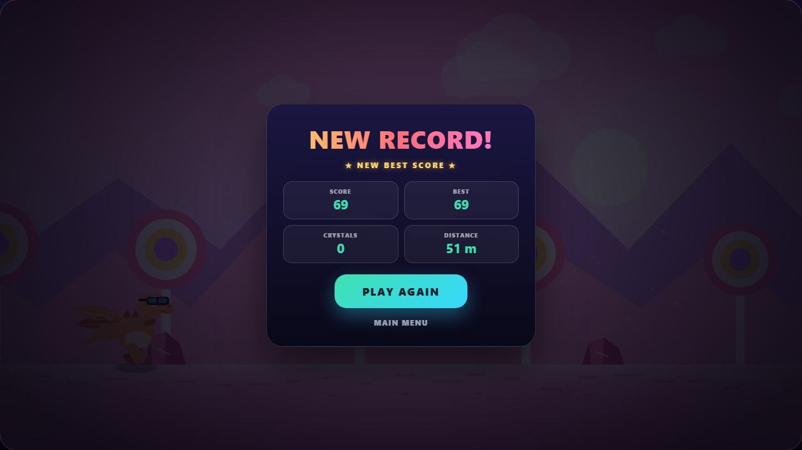
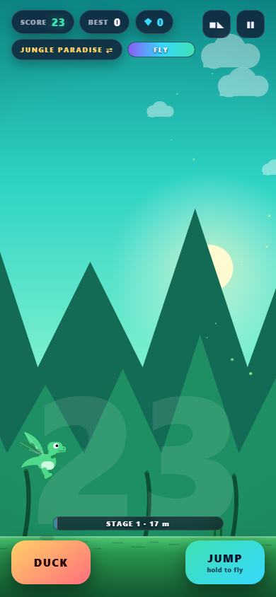

# 🦖 DINOVERSE — *Your Dino. Your World. Your Adventure.*

An endless runner inspired by the Chrome offline dino — rebuilt as a colourful arcade game with
**dragon flight**, **live character customisation**, and **six hand-drawn worlds you can swap
mid-run**.

Everything is drawn procedurally on an HTML5 canvas and every sound is synthesised with the Web
Audio API. **No images, no fonts, no CDNs, no libraries, no build step.** Open the file and play —
online or off.



---

## ▶ Play

```bash
git clone https://github.com/sandhiya-s86/dinoverse.git
cd dinoverse
start index.html        # Windows   (macOS: open index.html · Linux: xdg-open index.html)
```

That's it. No `npm install`, no server, no bundler. Double-clicking `index.html` works too.

---

## 🎮 Controls

| Action | Keyboard / Mouse | Touch |
| --- | --- | --- |
| Jump | `Space` · `↑` · `W` · click | tap the screen or **JUMP** |
| **Fly** | **hold** the jump key | **hold** **JUMP** |
| Duck / slide | hold `↓` or `S` | hold **DUCK** |
| Fast-fall | `↓` while airborne | — |
| Change world instantly | `1`–`6`, or click the world chip | tap the world chip |
| Pause / resume | `P` or `Esc` | ❚❚ button |
| Restart | `R` | **PLAY AGAIN** |
| Start | `Enter` | **START ADVENTURE** |

---

## ✨ Features

### Flight, not just jumping
Hold the jump key in mid-air and the dino spreads its wings and climbs. It's bounded, not a
free pass:

* a **flight-energy meter** gives roughly 1.6 s of lift (drains 0.6/s, refuels 0.5/s on the ground)
* crystals refuel it — ordinary ones `+0.14`, sky crystals `+0.22`
* climb speed is capped at −300 px/s with a hard ceiling, so you can't leave the playfield
* **sky-crystal arcs** sit 130–200 units up and are worth 15 each — only reachable by flying
* **sky-patrol pterodactyls** cruise at the same altitude, so the upper lane has its own risk



### Six worlds, one engine
Each world is a plain theme object — sky gradient, sun/moon, two mountain layers, a scenery
generator, ground palette, ambient particle type, obstacle and crystal colours. The renderer reads
whichever theme is selected, so there's no duplicated game code.

| # | World | Look |
| --- | --- | --- |
| 1 | **Golden Dunes** | orange sunset, warm desert, mesas |
| 2 | **Jungle Paradise** | turquoise sky, layered palms, drifting leaves |
| 3 | **Candy Kingdom** | pink/lavender sky, lollipop trees, floating sparkles |
| 4 | **Volcano Rush** | ember particles, glowing craters, charcoal ground |
| 5 | **Neon Cyber City** | indigo sky, glowing cyan/magenta towers, data-bit particles |
| 6 | **Rainbow Sky** | floating islands, rainbow gradients, magical crystals |

Switch worlds from the World Studio **or mid-run** with `1`–`6`.




### Dino Lab
8 body skins including an animated **Rainbow Mode** (live HSL cycle) and two crystal-locked
skins — **Rainbow** (◆30) and **Void Crystal** (◆60) — unlocked with crystals you actually
collect. 4 accessories (sunglasses, crown, party hat, none) drawn at the correct head anchor and
carried straight into gameplay. Plus a randomiser and a live preview rendered in the real canvas.



### The runner itself
* delta-time `requestAnimationFrame` loop, clamped to 50 ms so a tab switch can't teleport you
* gravity, **coyote time** (0.1 s) and **jump buffering** (0.13 s) so jumps feel forgiving
* 3 obstacle families — cactus clusters (1–3, scaling with score), faceted boulders, and
  pterodactyls at three altitudes: knee height (jump), head height (duck), sky (only if you fly)
* per-type collision boxes inset to match the drawn art
* speed ramps 320 → 650; obstacle gaps scale with speed so it stays fair
* crystals with a combo multiplier up to ×5, plus a rare **shield orb** that absorbs one hit
* **3 stages** — the palette smoothly deepens toward night and neon at 650 and 1500 points



### Game feel
Running dust, landing puffs, flap particles, crystal sparkle bursts, floating `+10` text, screen
shake and a white flash on impact, parallax clouds and mountains, a ghost score behind the action,
and a vignette. The particle pool is hard-capped at 240.



### Everything else
* **Responsive** — DPR-capped canvas, virtual coordinate space clamped to 500–1120 units so the
  dino stays readable in portrait, re-layout on resize and orientation change
* **Touch** — thumb JUMP/DUCK buttons on coarse-pointer devices, hidden on mouse devices
* **Persistence** — best score, lifetime crystals, owned skins, selected skin/accessory/world and
  mute, all behind a `try`/`catch` wrapper that silently degrades to in-memory if storage is blocked
* **Audio** — oscillator-only SFX (jump, flap, land, crystal, rising combo pitch, hit, shield, UI),
  booted lazily on first gesture to respect autoplay policies, with a mute toggle
* auto-pause when the tab is hidden; `prefers-reduced-motion` honoured



---

## 📁 Project

```
index.html      markup, HUD, overlays, menus
style.css       design system, panels, responsive layout
game.js         the whole engine — themes, physics, render, input, state
screenshots/    captured from the running game
```

`game.js` is one IIFE with no globals, organised into `initGame` · `startGame` · `resetGame` ·
`update` · `render` · `drawDinosaur` · `drawBackground` · `drawGround` · `drawObstacles` ·
`drawCollectibles` · `spawnObstacle` · `spawnCrystal` · `checkCollisions` · `updateParticles` ·
`gameOver` · `pauseGame` · `resumeGame` · `selectSkin` · `selectWorld`.

---

## ✅ Verified

Driven headlessly with Playwright — title → Dino Lab (skin + accessory persisted) → locked-skin
message → World Studio → gameplay → duck → pause freezes the score → resume → game over →
restart resets cleanly → reload keeps best/crystals/world → mobile portrait touch controls → all
six worlds render → flight meter drains under a held key and refuels on landing.
**0 console errors, 0 page errors.**

## ⚠️ Known limitations

* Flight makes ground obstacles largely skippable while the meter has charge; sky patrols offset
  this but it isn't balanced over a long session. Lower the refuel rate in `update` to tighten it.
* The near wing overlaps the torso at some flap angles — readable, but not a perfect silhouette.
* No landscape lock on phones.
* Audio is code-verified but was never *heard*, since headless Chromium produces no sound.

---

Built with vanilla HTML, CSS and JavaScript. No dependencies, no network, no build.
